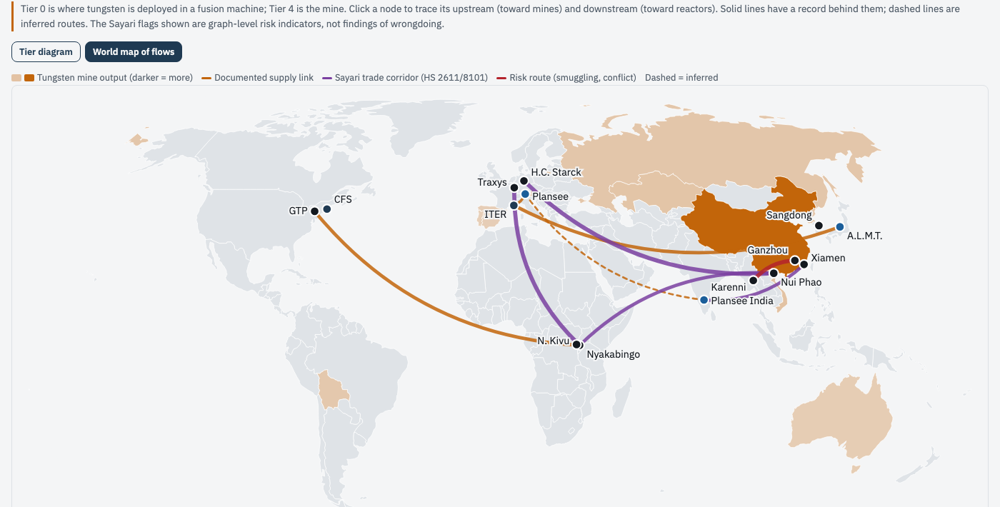

# Fusion Tungsten Tier Map

An open-source-intelligence (OSINT) map of tungsten from mine to fusion reactor. It covers the materials fusion plants need, why tungsten is the one to trace, a five-tier supply chain (deployment → component → powder/APT → concentrate → mine), the top five human-rights risks along it, and a one-page policy brief. It follows the same format as the Lindt Cocoa Tier Map.

**Live site:** https://bkrashi.github.io/fusion-tungsten-tier-map/

## What it shows
Overview · Systems Map (D3 tier explorer + D3/topojson world map of flows) · Risks (severity × traceability matrix, evidence) · Policy Brief · Methodology (tools, queries, data limits, evidence locker). A confidence filter (Confirmed / Reported / Sayari record / Inferred) and global search apply everywhere. Every claim carries citation chips that link to its source: `S`-numbered IDs are web sources and `X`-numbered IDs are Sayari records.

## Run locally
No build step. ES modules need HTTP: run `python3 -m http.server 8000` in this folder and open http://localhost:8000.

## Update the data (no code changes)
All content lives in `data/`:
- `site.json`: overview, materials table, brief, methodology
- `entities.json`: tier nodes, with Sayari flags and IDs
- `relationships.json`: supplier → buyer links
- `geo.json`: producers, map nodes and flows
- `risks.json`
- `sources.json`

Text written with `[S01, X05]` markers turns into citation links. The world map uses `countries-110m.json` (world-atlas 2.0.2) stored locally, so it needs no tile server.

## Research tools
Tavily (web search and extraction) and Sayari (corporate registry, trade and watchlist graph), both accessed through Claude, plus USGS Mineral Commodity Summaries 2026.

## Legal and ethics note
This is independent research from public sources and the Sayari graph; it is not legal advice. Sayari risk flags are graph-level indicators, not findings of wrongdoing. Sayari shows no tungsten shipments into ITER or Commonwealth Fusion Systems, so the routes from mines to reactors are sector-level and do not show that tungsten from any specific abusive mine reached a reactor. Corrections are welcome.

See [METHODOLOGY.md](METHODOLOGY.md).
